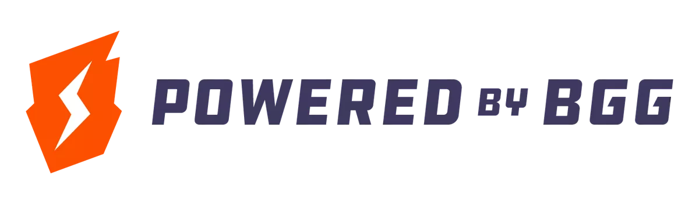
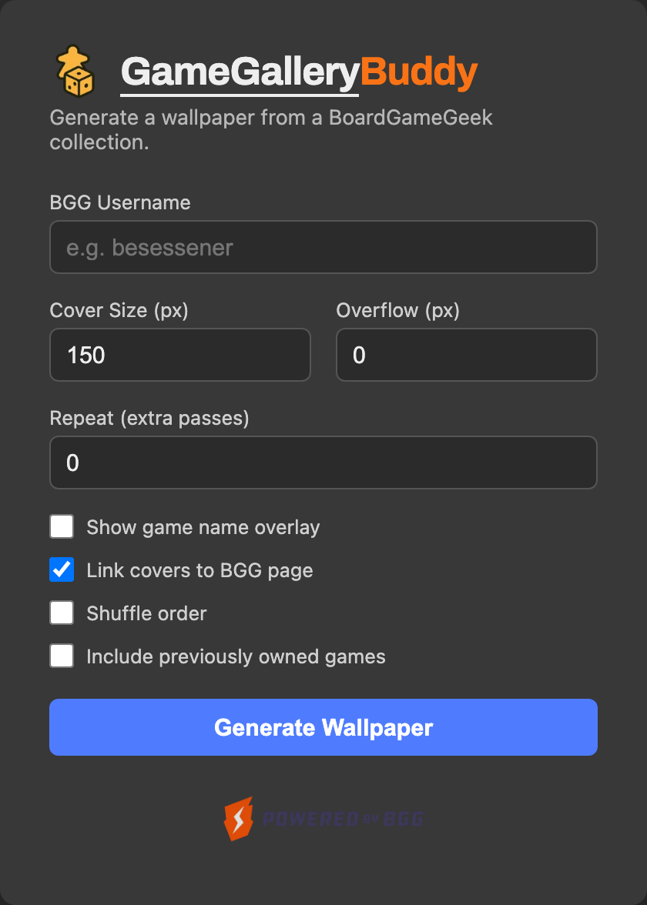

# GameGalleryBuddy

**Your board game shelf, as a wallpaper.** Enter a [BoardGameGeek](https://boardgamegeek.com) username and GameGalleryBuddy tiles every game cover from that collection into one wallpaper page. Use it as a desktop background, a second-screen display or a poster.

**Live:** [gamegallerybuddy.nobuddy.org](https://gamegallerybuddy.nobuddy.org/)





## Features

- **Any public collection:** Type a BGG username, click **Generate Wallpaper**, done. No sign-up.
- **Tunable layout:** Cover size, overflow past the screen edges and repeat passes for large displays.
- **Optional overlays:** Show game names on the covers, or make each cover link to its BGG page.
- **Shuffle:** Mix the order up, or keep the collection's original order.
- **Previously owned:** Include games marked as _previously owned_. Owned games are always included.
- **Adjust in place:** Hover the top-right corner of a wallpaper to open the settings panel (⚙), change options and hit **Apply** to regenerate.
- **Shareable URLs:** Every wallpaper is a plain `/collection` URL with query parameters (see [Parameters](#parameters)).

## Using the Live Site

1. Open [gamegallerybuddy.nobuddy.org](https://gamegallerybuddy.nobuddy.org/).
2. Enter your BGG username and adjust the options if you like.
3. Click **Generate Wallpaper**.
4. Bookmark the result, or use the settings panel (⚙) to tweak it.

Try the example wallpaper for the user `besessener`:

```
https://gamegallerybuddy.nobuddy.org/collection?username=besessener&size=85&showName=no&showUrl=no&shuffle=yes&overflow=20&repeat=1
```


## Parameters

The form and settings panel cover all of these. They also work directly as `/collection` query parameters.

| Parameter          | Required | Default | Description                                                                              |
| ------------------ | -------- | ------- | ---------------------------------------------------------------------------------------- |
| `username`         | ✅ Yes   | —       | BGG username of the collection owner.                                                    |
| `size`             | ❌ No    | `150`   | Size (in pixels) of each board game cover on the wallpaper.                              |
| `showName`         | ❌ No    | `false` | Whether to display the game name as an overlay on the image.                             |
| `showUrl`          | ❌ No    | `true`  | Whether to make game images clickable, linking to their BGG pages.                       |
| `shuffle`          | ❌ No    | `false` | Shuffle the games randomly (if `true`) or keep their original order.                     |
| `overflow`         | ❌ No    | `0`     | Allows images to overflow the container edges, in pixels.                                |
| `repeat`           | ❌ No    | `0`     | Repeats the image list `(repeat + 1)` times to extend the wallpaper.                     |
| `includePrevOwned` | ❌ No    | `false` | Also include games marked as _previously owned_ on BGG. Owned games are always included. |

## Run It Yourself

The hosted site is the easiest way to use GameGalleryBuddy. To run your own copy (Spring Boot, Java 21), you need a BoardGameGeek API token:

1. Generate a token at [boardgamegeek.com/applications](https://boardgamegeek.com/applications).
2. Create a `.env` file in the project root:

   ```env
   BGG_API_TOKEN=your-token-here
   ```

3. Start the app and choose Docker, Gradle or tests-only:

   ```bash
   ./run.sh
   ```

4. Open <http://localhost:8080/>.

Deployment recipes (Terraform and Ansible) live in [`deploy/`](deploy).

## Contributing

GameGalleryBuddy is a personal hobby project and doesn't accept outside pull requests, issues or feature requests; they are closed without review. Want to change something? Fork it — the MIT License allows it. See [CONTRIBUTING.md](CONTRIBUTING.md).

## License

This project is licensed under the [MIT License](LICENSE). Game data and cover images come from [BoardGameGeek](https://boardgamegeek.com).
